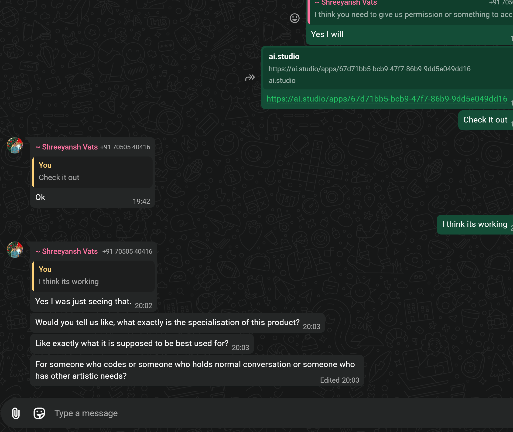
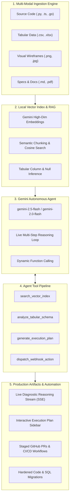

<div align="center">

# ⚡ Remix OmniAgent
### Autonomous Multi-Modal AI Copilot & Technical Execution Engine
**Built for HackGlobal**

[](https://ai.google.dev/)
[](https://react.dev/)
[](https://www.typescriptlang.org/)
[](https://tailwindcss.com/)
[](LICENSE)

*Transforming unstructured codebases, performance CSVs, architectural wireframes, and engineering specs into autonomous, production-ready technical remediation workflows.*

<br/>



---
</div>

## 📌 The Problem
During production outages and architectural refactors, critical context is fractured across disconnected modalities:
- **Legacy code** (hidden N+1 queries, unindexed queries, SQL injection risks)
- **Telemetry data** (millions of CSV/Excel performance rows with tail latencies and error spikes)
- **Architectural diagrams** (topology wireframes, service dependency blueprints)
- **Sprint specifications** (unstructured Markdown or PDF technical requirement docs)

Engineers spend 70% of their triage time manually correlating these disparate sources before writing a single line of remediation.

## 🚀 The Solution: OmniAgent
**Remix OmniAgent** is an autonomous multi-modal technical copilot that ingests, parses, embeds, and reasons across multi-format artifacts simultaneously. Powered by Google Gemini's advanced multimodal reasoning and autonomous tool calling, OmniAgent:
1. **Performs Multi-Modal Vector RAG** across code, documents, CSV schemas, and visual diagrams.
2. **Executes Autonomous Diagnostics** with full transparency, streaming live reasoning traces across 8 operational phases.
3. **Generates Interactive Execution Plans** breaking down remediation into ordered, verifiable phases.
4. **Stages Production-Grade Webhooks & PR Patches** generating complete, runnable CI/CD pipelines, SQL migrations, and Git PR payloads.

---

## 🏗️ System Architecture



---

## ✨ Key Features

- **Multi-Modal Deep Chunking & Parsing:** Ingests Python/TypeScript codebases, parses CSV/Excel with column type inference and null detection, and reads architectural PNG topology wireframes.
- **In-Memory Semantic Vector Index:** Computes cosine-similarity embeddings using the official `@google/genai` SDK for low-latency retrieval.
- **Transparent Agentic Reasoning Traces:** Live real-time Server-Sent Events (SSE) displaying steps across 8 phases: `INGESTION`, `EMBEDDING`, `RAG_RETRIEVAL`, `REASONING`, `TOOL_CALL`, `WEBHOOK_HOOK`, `SYNTHESIS`, and `SECURITY`.
- **Structured Execution Blueprints:** Automatically populates a checkable, phased engineering execution plan in the UI.
- **Automated Webhook Actions:** Stages complete runnable scripts, GitHub Actions workflows, Docker security configs, and task manager integrations.
- **Enterprise Privacy Sandbox:** Client-side sandbox isolation with single-click sanitization and zero external data leaks.

---

## 🎬 2-Minute Demo: The "Sprint 14" Scenario

OmniAgent includes a pre-packaged incident remediation bundle out-of-the-box:

1. **Load Sample Bundle:** Click **"Load Sample Bundle"** in the Ingestion Panel. This immediately stages:
   - `order_service.py`: A legacy FastAPI service with an unindexed SQL query, N+1 loop, and blocking synchronous HTTP call.
   - `latency_telemetry.csv`: Endpoint metrics showing p99 latency of 3,420 ms and 4.8% error rate on `/api/orders/{customer_id}`.
   - `architecture_spec.md`: Sprint remediation requirements and SLA targets.
   - `service_topology_wireframe.png`: Architectural system wireframe highlighting missing Redis cache and database bottlenecks.
2. **Execute Remediation:** Click the starter prompt **"Bottleneck Audit & Remediation Plan"**.
3. **Observe OmniAgent:**
   - Detects the bottleneck correlation between the CSV p99 spikes and the Python N+1 loop.
   - Identifies the unindexed query and generates an optimized SQL composite index migration.
   - Generates fully async `httpx` refactored code with Redis caching.
   - Dispatches a GitHub PR action and a complete GitHub Actions CI/CD pipeline workflow.

---

## 🛠️ Quickstart & Local Setup

### Prerequisites
- **Node.js** (v18+ or v20+)
- **Google Gemini API Key** ([Get a key from Google AI Studio](https://aistudio.google.com/))

### 1. Clone & Install
```bash
git clone https://github.com/your-username/remix-omniagent.git
cd remix-omniagent
npm install --legacy-peer-deps
```

### 2. Configure Environment
Create a `.env` file in the root directory:
```bash
cp .env.example .env
```
Add your Gemini API Key in `.env`:
```env
GEMINI_API_KEY="your_actual_gemini_api_key_here"
PORT=3000
```

### 3. Run Development Server
```bash
npm run dev
```
Open **[http://localhost:3000](http://localhost:3000)** in your browser.

---

## 📂 Repository Structure

```
├── server.ts                  # Express server, SSE streaming, Gemini agent loop
├── server/
│   ├── geminiClient.ts        # @google/genai client with exponential backoff
│   ├── agentTools.ts          # Declarations & executors for agent function calls
│   ├── ingestion.ts           # Multi-modal file parsers (Code, CSV, PNG, PDF, Audio)
│   ├── rag.ts                 # In-memory vector store & cosine similarity search
│   └── sampleBundles.ts       # Preloaded multi-modal demo dataset & PNG generator
├── src/
│   ├── App.tsx                # Main application state & theme orchestrator
│   ├── types/omniagent.ts     # TypeScript interfaces for artifacts, logs & plans
│   └── components/
│       ├── ChatWorkspace.tsx  # Streaming chat UI with citations & reasoning traces
│       ├── ExecutionSidebar.tsx # Interactive execution plan & webhook runner
│       ├── IngestionPanel.tsx # Multi-file uploader & sample bundle loader
│       ├── ArtifactPreviewModal.tsx # Full-screen preview for tables, code & images
│       └── TopBar.tsx         # Navigation header & sandbox reset
└── package.json
```

---

## 🏆 HackGlobal Submission Summary

- **Primary Track:** Enterprise AI Agents / Autonomous Copilots
- **Core Technology:** Google Gemini Multimodal Reasoning (`@google/genai`), Tool Calling / Structured Function Outputs, Vector Search
- **Deliverables:** Working full-stack web application, live multi-modal triage workflow, automated webhook CI/CD staging, production-ready remediation code.

---
*Built with ❤️ for HackGlobal.*
